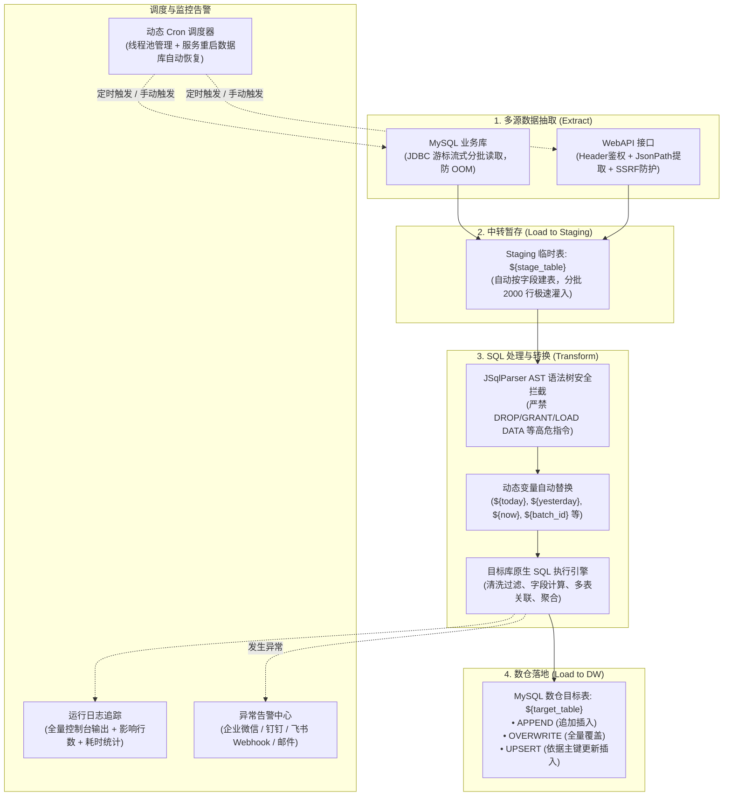

# DHP 轻量级 Web-ETL 数据集成与调度系统

> **定位**：基于 Web 网页形式的轻量级 ELT（Extract-Load-Transform）数据集成与定时调度平台。  
> **核心特性**：支持双输入源（MySQL / WebAPI）抽取、Staging 临时表中转、原生 SQL 脚本清洗转换、写入 MySQL 数仓、280px 树形多目录流程管理、动态 Cron 定时调度与服务重启恢复、多通道（企业微信/钉钉/飞书/邮件）异常告警。  
> **团队规范**：严格遵循 `dhp-product-specification/rules`（后端规范 `03`、前端规范 `04`、枚举管理 `06`、接口契约 `07`、UI/UE 规范 `16`）。

---

## 一、 系统架构与处理流程 (ELT)



---

## 二、 技术栈与版本规格

| 层次 | 核心技术 / 组件 | 版本 | 说明 |
|---|---|---|---|
| **语言与运行时** | Java SE Development Kit | **21 LTS** | 现代化模式匹配、记录类等新特性 |
| **后端框架** | Spring Boot | **3.2.5** | Spring Framework 6.x 底座 |
| **ORM / 持久层** | MyBatis-Plus | **3.5.5** | 自动分页、乐观锁、逻辑删除注入 |
| **数据库** | MySQL | **8.0+ / 8.4** | utf8mb4_0900_ai_ci 编码 |
| **连接池** | HikariCP | **5.0.1** | 高性能数据库连接池与动态源缓存 |
| **SQL 语法分析** | JSqlParser | **4.6** | AST 语法树遍历与安全白名单校验 |
| **安全加解密** | Jasypt / AES-256 | **3.0.5** | 数据源密码可逆对称加密存储 |
| **WebAPI 解析** | Jayway JsonPath | **2.9.0** | 动态从复杂 JSON 响应中提取记录数组 |
| **前端框架** | Vue 3 + TypeScript | **Vue 3.5 / TS 5.9** | Composition API、SFC 单文件组件 |
| **构建工具** | Vite | **5.4.21** | 极速冷启动与热重载，预置 API 代理 |
| **UI 组件库** | Ant Design Vue | **4.2.6** | 遵循规范 16 标准企业级视觉交互 |
| **包管理器** | pnpm | **11.x** | 快速硬链接依赖管理 |

---

## 三、 工程目录结构

```
E:\3-code\ERPwebAPI/
├── sql/
│   └── schema.sql                               # 数据库初始化全量 DDL 脚本
├── etl-server/                                  # 后端服务工程
│   ├── pom.xml                                  # Maven 依赖配置
│   └── src/main/
│       ├── java/com/dhp/
│       │   ├── common/                          # 规范 03 基础基类包
│       │   │   ├── result/                      # R<T> 信封、PageResult、ErrorCode
│       │   │   ├── exception/                   # BizException、GlobalExceptionHandler
│       │   │   ├── entity/                      # BaseEntity、BaseTenantEntity (审计/逻辑删除/乐观锁)
│       │   │   ├── base/                        # BaseCrudController、IBaseCrudService、BaseCrudServiceImpl
│       │   │   └── util/                        # PageQueryUtils (动态分页与多字段多条件筛选)
│       │   └── etl/                             # ETL 核心业务包
│       │       ├── EtlApplication.java          # 启动类 (@MapperScan + @EnableScheduling)
│       │       ├── config/                      # MyBatisPlusConfig、SchedulerConfig
│       │       ├── enums/                       # SourceTypeEnum、WriteModeEnum、TaskStatusEnum 等
│       │       ├── entity/                      # 5 张业务表实体映射类
│       │       ├── mapper/                      # MyBatis-Plus 数据访问接口
│       │       ├── service/ & impl/             # 业务逻辑与事务控制
│       │       ├── controller/                  # 继承 BaseCrudController 的控制器与扩展接口
│       │       └── core/                        # ★ 核心 ETL 与调度引擎
│       │           ├── guard/SqlSafetyGuard     # JSqlParser AST 白名单守卫
│       │           ├── extractor/MySqlExtractor # 流式游标抽取组件
│       │           ├── extractor/WebApiExtractor# WebAPI + JsonPath + SSRF 校验组件
│       │           ├── loader/MySqlDwLoader     # 临时表管理与批量写入组件
│       │           ├── transformer/SqlTransform # 变量替换与多段 SQL 执行器
│       │           ├── schedule/DynamicCronScheduler # 动态 Cron 调度与就绪自动恢复
│       │           ├── alert/AlertService       # 企微 / 钉钉 / 飞书 / 邮件告警中心
│       │           └── PipelineExecutor         # 全生命周期流水线执行与自动重试
│       └── resources/
│           ├── application.yml                  # 核心配置
│           ├── application-local.yml            # 本地环境数据库连接
│           └── db/migration/V1__init_etl_tables.sql
├── etl-ui/                                      # 前端控制台工程
│   ├── index.html / vite.config.ts / tsconfig.json / package.json
│   └── src/
│       ├── types/index.ts                       # 统一 TS 类型声明 (Snowflake ID 均采用 string)
│       ├── api/                                 # 接口层 (request.ts 解包 R<T> 信封)
│       ├── components/
│       │   ├── FolderTree.vue                   # 280px 左侧目录树组件 (增删改重命名与搜索)
│       │   ├── SqlEditor.vue                    # 代码高亮编辑器 (动态变量一键插入、AST安全预检)
│       │   ├── PipelineDrawer.vue               # 流程配置大抽屉 (输入源/SQL处理/目标库/Cron)
│       │   ├── InstanceLogDrawer.vue            # 批次日志追踪抽屉 (历史批次/全量控制台日志)
│       │   ├── DatasourceModal.vue              # 数据源连接弹窗 (带在线连通性测试)
│       │   └── AlertModal.vue                   # 机器人通道管理弹窗
│       ├── App.vue                              # 规范 16-07 “左树右列表” 工作台主布局
│       └── main.ts                              # 前端主入口
└── README.md
```

---

## 四、 快速启动与本地运行

### 0. 端口分配

本项目的端口刻意避开了同机其他项目已占用的段位（`dhp-biz-iot-ui` 用 `3000`、`dhp-biz-bi-ui` 用 `3008`、BI 后端用 `8070`，以及平台常用的 `8050-8100`、`8888-9003`），确保多个项目可以同时启动。

| 服务 | 端口 | 访问地址 | 配置位置 |
|---|---|---|---|
| etl-server（Spring Boot） | **8388** | http://localhost:8388 | `etl-server/src/main/resources/application.yml` |
| etl-ui（Vite Dev Server） | **3800** | http://localhost:3800 | `etl-ui/vite.config.ts` |
| MySQL | **3306** | 127.0.0.1:3306 | `etl-server/src/main/resources/application-local.yml` |

> 前端所有 `/etl/**` 请求由 Vite 代理转发到 `http://localhost:8388`，因此对外只需暴露 3800 一个端口即可访问完整系统。

### 1. 数据库初始化

本机数据库为**便携版 MySQL 8.4**（未注册 Windows 服务），位于 `E:\3-code\MySQL`：

```bash
# 1) 启动 MySQL（无服务注册，每次需手工拉起）
E:\3-code\MySQL\mysql-8.4.11-winx64\bin\mysqld.exe --defaults-file=E:\3-code\MySQL\my.ini

# 2) 首次建库建表（密码见 application-local.yml，默认 Root123456）
E:\3-code\MySQL\mysql-8.4.11-winx64\bin\mysql.exe -h 127.0.0.1 -P 3306 -u root -p --default-character-set=utf8mb4 < sql/schema.sql
```

> ⚠️ `sql/schema.sql` 是**重建脚本**，内含 `DROP TABLE IF EXISTS`。重复执行会清空已有的流程、数据源与运行日志，库已存在时请勿再次执行。

执行后将自动创建 `dhp_etl` 数据库及 6 张主表：
- `t_etl_folder`：目录树分类表
- `t_etl_datasource`：外部 MySQL 与数仓连接表
- `t_etl_pipeline`：ETL 流程配置主表
- `t_etl_task_instance`：任务运行日志与批次实例表
- `t_etl_alert_config`：企业微信 / 钉钉 / 飞书告警配置表
- `t_etl_kingdee_credential`：金蝶登录凭证表（密码 AES 加密）

### 2. 启动后端服务 (etl-server)
```bash
cd E:\3-code\ERPwebAPI\etl-server

# 启动 Spring Boot 服务
mvn spring-boot:run
```
* **服务端口**：`8388`（如需临时换端口，可追加 `-Dspring-boot.run.arguments=--server.port=xxxx` 覆盖）
* **Swagger 在线 API 文档**：[http://localhost:8388/swagger-ui.html](http://localhost:8388/swagger-ui.html)
* **默认本地连接**：`application-local.yml`（可通过系统环境变量 `DB_PASSWORD`、`DB_HOST` 等覆盖）

### 3. 启动前端控制台 (etl-ui)
```bash
cd E:\3-code\ERPwebAPI\etl-ui

# 安装依赖 (首次)
pnpm install

# 启动开发服务器
pnpm dev
```
* **访问入口**：[http://localhost:3800/](http://localhost:3800/)
* **后端代理**：`/etl` → `http://localhost:8388`（见 `vite.config.ts`）
* **网络暴露**：已自动配置 `host: '0.0.0.0'`，支持局域网 IP 直连。

---

## 五、 核心模块功能详解

### 1. 数据抽取 (Source)
* **MySQL 模式**：
  * 选择预置的数据源连接，输入抽取 SQL。
  * 采用 JDBC 游标流式分批读取（`fetchSize=Integer.MIN_VALUE`），每 2000 行批量提交至 Staging 临时表，有效防止亿级大表提取导致 Java 堆内存溢出（OOM）。
* **WebAPI 模式**：
  * 支持自定义 `GET` / `POST` 请求方式。
  * 支持注入鉴权 Header（如 `{"Authorization": "Bearer token"}`）及 JSON 请求体模板。
  * 采用 JsonPath 灵活提取数组节点（例如 `$.data.records` 或 `$.result.list`）。
  * 内置 **SSRF 安全防护**，拦截内网私有 IP 探测。
  * **偏移量分页取数**（`api_pagination`，适用于金蝶等数据量大的接口）：

    | 配置项 | 说明 | 默认 |
    |---|---|---|
    | 分页取数 | 开关，关闭时走单次请求 | 关闭 |
    | 每页条数 | 每轮写入 `limitPath` 的值 | 2000 |
    | 最多取数次数 | 分页轮次上限，防止无限翻页 | 200 |
    | 起始偏移 | 第一页的偏移量 | 0 |
    | 增长间隔 | 每页递增的偏移步长 | 0（= 每页条数） |
    | 结束条件 | 本页条数 < 该值即停止 | 0（= 每页条数） |
    | 请求间隔 | 两次请求之间的休眠毫秒，用于限速 | 0 |
    | 偏移 / 每页字段路径 | 请求体中的 JSON 点号路径 | `data.StartRow` / `data.Limit` |

    每轮把 `起始偏移 + 页码 × 增长间隔` 与每页条数写回请求体，直到某页条数小于结束阈值或达到取数上限；运行日志逐页记录偏移量与本页/累计条数，触达上限时提示「可能仍有剩余数据」。
  * **抽取字段清单支持 Excel 批量维护**（金蝶单据动辄几十上百个字段，手工拼逗号串易错）：可下载模板批量填写后一键导入，也可把当前清单导出为 Excel 备份或批量修改。表格支持增删行、上下移动、逐行启停。
    * 导入按表头名称识别列，列顺序可随意调整；字段名含空格、逗号、中文会直接报错并定位到行号，重复字段自动去重。
    * **行序即 FieldKeys 序，也是临时表列序**：抽取结果按 FieldKeys 下标对齐金蝶返回的二维数组，调整顺序会改变列序。
    * 「启用=否」的行不进入 FieldKeys，但保留在清单中，可随时恢复。
    * **金蝶登录凭证加密存储**：登录地址、单据查询接口地址、账套、用户名与密码可一键保存到 `t_etl_kingdee_credential`（密码 AES 加密，**接口永不回显**）。之后点「载入默认凭证」即可自动填充登录信息与单据查询 URL，密码框回填 8 个星号占位（提交时自动转空，由后端取已保存密码）。仅当账套与用户名同时匹配才兜底，避免把 A 账号密码用到 B 账号上。
  * **从金蝶拉字段**：登录 K3Cloud 后调用 `DynamicFormService.QueryBusinessInfo`，自动带出表单全部字段的标识、中文名与数据类型，勾选后「追加」或「覆盖」到清单。首次拉取只预勾选清单里还没有的字段，避免覆盖手工调整。
    * **推断类型**：按字段名规则推断（`FID`/`*Id`→`BIGINT`、`*Date`→`DATE`、`*Time`→`DATETIME`、`*Amount`/`*Qty`/`*Price`→`DECIMAL(18,4)`…），只填充仍为 `TEXT` 的行。
    * 「中文名」「类型」随流程保存在 `t_etl_pipeline.field_meta`（JSON）。**类型会用于创建 Staging 临时表列**（如 `DECIMAL(18,4)`、`DATETIME`），未指定的列仍为 `TEXT`；类型白名单之外的取值一律降级为 `TEXT`。改动类型后，下次运行会自动比对并重建临时表。

### 2. SQL 转换与动态变量 (Transform)
用户编写的 SQL 处理脚本在目标数仓环境中执行，支持使用分号 `;` 分隔多段 SQL。

#### 支持的内置动态变量
| 变量名 | 含义 | 替换值示例 |
|---|---|---|
| `${today}` | 当天日期（yyyy-MM-dd） | `2026-10-12` |
| `${yesterday}` | 昨天日期（yyyy-MM-dd） | `2026-10-11` |
| `${now}` | 当前执行时间（yyyy-MM-dd HH:mm:ss） | `2026-10-12 10:00:00` |
| `${stage_table}` | 当前流程绑定的 Staging 临时表名 | `stg_sync_erp_materials` |
| `${target_table}` | 最终数仓目标表名 | `dwd_material_info` |
| `${batch_id}` | 本次任务运行的雪花批次 ID | `1844567890123456789` |
| `${pipeline_code}`| 当前流程业务唯一编码 | `sync_erp_materials` |

#### JSqlParser AST 安全白名单守卫
在保存与执行 SQL 脚本前，系统自动解析语法树：
- **允许的语句类型**：`SELECT`、`INSERT`、`UPDATE`、`DELETE`、`TRUNCATE`、`CREATE TABLE`（支持清空和重构临时表）。
- **严格拦截的高危操作**：`DROP DATABASE`、`GRANT`、`REVOKE`、`LOAD DATA INFILE`、`INTO OUTFILE`、`CALL sys.`、`SHUTDOWN` 等。
- 支持在前端界面点击 **“SQL 语法与安全校验”** 按钮直接进行预检。

### 3. 数仓写入策略 (Sink)
* **APPEND (追加插入)**：保留历史数据，每次抽取转换的数据直接 `INSERT INTO` 目标表。
* **OVERWRITE (全量覆盖)**：执行前清空目标表旧数据，再进行全量重灌。
* **UPSERT (按主键更新插入)**：根据配置的业务主键字段自动追加 `ON DUPLICATE KEY UPDATE`，存在则更新，不存在则插入。

### 4. 动态定时调度与启动恢复 (Schedule)
* 基于 Spring `ThreadPoolTaskScheduler`，通过 `CronTrigger` 动态注册与注销任务。
* 支持快捷预置表达式（如每 5 分钟、每小时整点、每天凌晨 2 点等）。
* **启动自动恢复**：通过监听 `ApplicationReadyEvent`，服务重启后自动从数据库查询所有 `schedule_status = 1` 的流程并重新装载定时器，防止单机重启造成调度丢失。

### 5. 监控日志与告警通道 (Alert)
* **执行日志追踪**：保留每次调度的批次 ID、触发类型（手动/定时）、开始/结束时间、耗时、提取行数、影响行数、异常摘要及全量控制台输出。
* **多通道告警推送**：当流程发生 SQL 报错、网络超时或源库断开时，自动向绑定的告警通道发送 Markdown 格式告警卡片，支持：
  * 企业微信群机器人 Webhook
  * 钉钉群机器人 Webhook
  * 飞书群自定义机器人 Webhook
  * 邮件通知列表

---

## 六、 规范遵从对照表

| 团队规范 | 落实条款 | 本系统对应实现 |
|---|---|---|
| **rules/03 后端规范** | §3.1 实体规范 | 全部实体继承 `BaseTenantEntity`，包含雪花 ID、审计字段、逻辑删除 `object_status_cd` 与乐观锁 `object_version` |
| | §3.2 响应规范 | 统一通过 `R<T>` 信封类返回 `{ code: 0, message, data, timestamp }` |
| | §3.3 分页规范 | 分页接口统一封装为 `PageResult<T>` 格式 `{ list, total, page, size }` |
| | §4.5 控制器层 | 控制器全量继承 `BaseCrudController<T>`，开箱自带 6 个标准 RESTful 端点，并按需补充扩展接口 |
| | §7.2 插件顺序 | `MyBatisPlusConfig` 严格按“乐观锁插件 → 分页插件”顺序装配 |
| **rules/04 前端规范** | §1.2 目录结构 | 前端按照 `api/`、`components/`、`types/` 标准目录组织 |
| | §3.2 API 层 | 统一通过 Axios 拦截器解包 `R<T>`，错误状态全局统一弹窗通知 |
| **rules/06 枚举管理** | §1 编码规范 | 枚举类型使用业务大写英文字符串（如 `MYSQL`、`APPEND`、`SUCCESS`），数据库存储 VARCHAR，禁止存无含义魔数 |
| **rules/07 接口契约** | §3 条款 B3 | 前端所有 ID 均强制声明为 `string` 类型，杜绝 19 位雪花 ID 传输至浏览器时的精度截断丢失 |
| **rules/16 UI/UE 规范** | §07 页面模式 | 主界面严格采用 **左树右列表模式**（左侧 280px 目录导航树，右侧筛选栏 + 动态表格 + 操作栏） |

---

## 七、 授权与维护

* **归属**：DHP 团队规范标杆项目
* **维护支持**：如需扩展 Kafka/ClickHouse 数据源，可基于 `core/extractor` 与 `core/loader` 拓展对应接口实现。
