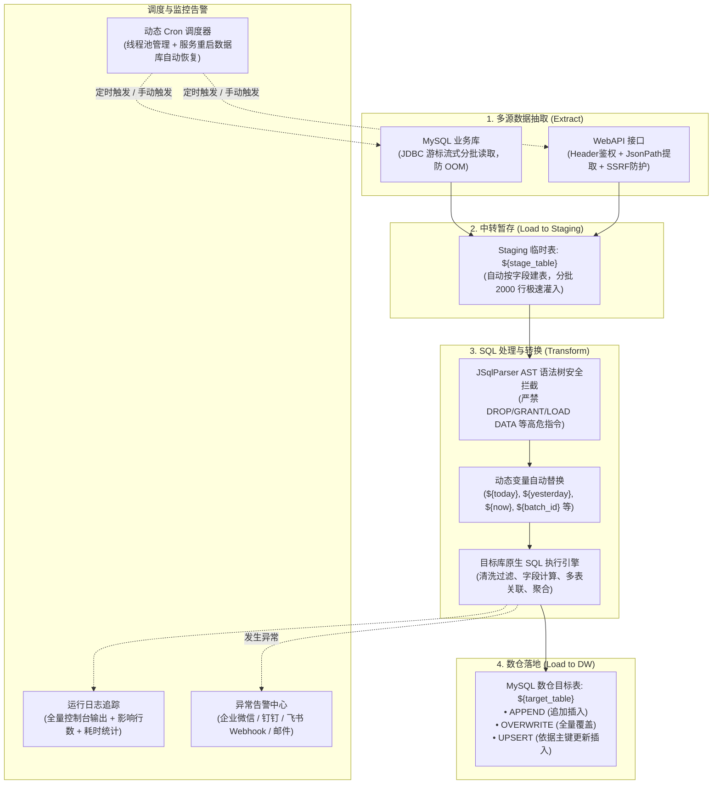

# DHP 轻量级 Web-ETL 数据集成与调度系统

> **定位**：基于 Web 网页形式的轻量级 ELT（Extract-Load-Transform）数据集成与定时调度平台。  
> **核心特性**：支持双输入源（MySQL / WebAPI）抽取、**金蝶单据与报表取数自动识别**、Staging 临时表中转、原生 SQL 脚本清洗转换、写入 MySQL 数仓、280px 树形多目录流程管理、动态 Cron 定时调度与服务重启恢复、多通道（企业微信/钉钉/飞书/邮件）异常告警。  
> **团队规范**：严格遵循 `dhp-product-specification/rules`（后端规范 `03`、前端规范 `04`、枚举管理 `06`、接口契约 `07`、UI/UE 规范 `16`）。

---

## 一、 系统架构与处理流程 (ELT)



---

## 二、 技术栈与版本规格

| 层次 | 核心技术 / 组件 | 版本 | 说明 |
|---|---|---|---|
| **语言与运行时** | Java SE Development Kit | **21 LTS** | 现代化模式匹配、记录类等新特性 |
| **后端框架** | Spring Boot | **3.2.5** | Spring Framework 6.x 底座 |
| **ORM / 持久层** | MyBatis-Plus | **3.5.5** | 自动分页、乐观锁、逻辑删除注入 |
| **数据库** | MySQL | **8.0+ / 8.4** | utf8mb4_0900_ai_ci 编码 |
| **连接池** | HikariCP | **5.0.1** | 高性能数据库连接池与动态源缓存 |
| **SQL 语法分析** | JSqlParser | **4.6** | AST 语法树遍历与安全白名单校验 |
| **安全加解密** | Jasypt / AES-256 | **3.0.5** | 数据源密码可逆对称加密存储 |
| **WebAPI 解析** | Jayway JsonPath | **2.9.0** | 动态从复杂 JSON 响应中提取记录数组 |
| **前端框架** | Vue 3 + TypeScript | **Vue 3.5 / TS 5.9** | Composition API、SFC 单文件组件 |
| **构建工具** | Vite | **5.4.21** | 极速冷启动与热重载，预置 API 代理 |
| **UI 组件库** | Ant Design Vue | **4.2.6** | 遵循规范 16 标准企业级视觉交互 |
| **包管理器** | pnpm | **11.x** | 快速硬链接依赖管理 |

---

## 三、 工程目录结构

```
E:\3-code\ERPwebAPI/
├── sql/
│   └── schema.sql                               # 数据库初始化全量 DDL 脚本
├── etl-server/                                  # 后端服务工程
│   ├── pom.xml                                  # Maven 依赖配置
│   └── src/main/
│       ├── java/com/dhp/
│       │   ├── common/                          # 规范 03 基础基类包
│       │   │   ├── result/                      # R<T> 信封、PageResult、ErrorCode
│       │   │   ├── exception/                   # BizException、GlobalExceptionHandler
│       │   │   ├── entity/                      # BaseEntity、BaseTenantEntity (审计/逻辑删除/乐观锁)
│       │   │   ├── base/                        # BaseCrudController、IBaseCrudService、BaseCrudServiceImpl
│       │   │   └── util/                        # PageQueryUtils (动态分页与多字段多条件筛选)
│       │   └── etl/                             # ETL 核心业务包
│       │       ├── EtlApplication.java          # 启动类 (@MapperScan + @EnableScheduling)
│       │       ├── config/                      # MyBatisPlusConfig、SchedulerConfig
│       │       ├── enums/                       # SourceTypeEnum、WriteModeEnum、TaskStatusEnum 等
│       │       ├── entity/                      # 5 张业务表实体映射类
│       │       ├── mapper/                      # MyBatis-Plus 数据访问接口
│       │       ├── service/ & impl/             # 业务逻辑与事务控制
│       │       ├── controller/                  # 继承 BaseCrudController 的控制器与扩展接口
│       │       └── core/                        # ★ 核心 ETL 与调度引擎
│       │           ├── guard/SqlSafetyGuard     # JSqlParser AST 白名单守卫
│       │           ├── extractor/MySqlExtractor # 流式游标抽取组件
│       │           ├── extractor/WebApiExtractor# WebAPI + JsonPath + SSRF 校验组件
│       │           ├── extractor/KingdeeMetadataClient # 金蝶 QueryBusinessInfo 字段元数据与表单类型识别
│       │           ├── extractor/KingdeeReportClient   # 金蝶报表取数（试取一行推断字段）
│       │           ├── loader/MySqlDwLoader     # 临时表管理与批量写入组件
│       │           ├── transformer/SqlTransform # 变量替换与多段 SQL 执行器
│       │           ├── schedule/DynamicCronScheduler # 动态 Cron 调度与就绪自动恢复
│       │           ├── alert/AlertService       # 企微 / 钉钉 / 飞书 / 邮件告警中心
│       │           └── PipelineExecutor         # 全生命周期流水线执行与自动重试
│       └── resources/
│           ├── application.yml                  # 核心配置
│           ├── application-local.yml            # 本地环境数据库连接
│           └── db/migration/V1__init_etl_tables.sql
├── etl-ui/                                      # 前端控制台工程
│   ├── index.html / vite.config.ts / tsconfig.json / package.json
│   └── src/
│       ├── types/index.ts                       # 统一 TS 类型声明 (Snowflake ID 均采用 string)
│       ├── api/                                 # 接口层 (request.ts 解包 R<T>、统一错误提示、silent 开关)
│       ├── utils/fieldKeysExcel.ts              # 字段清单 Excel 导入导出、类型推断
│       ├── components/
│       │   ├── FolderTree.vue                   # 280px 左侧目录树组件 (增删改重命名与搜索)
│       │   ├── SqlEditor.vue                    # 代码高亮编辑器 (动态变量一键插入、AST安全预检)
│       │   ├── PipelineEditor.vue               # 流程配置设计器 (5 个子 Tab：基础/抽取/转换/目标/调度)
│       │   ├── InstanceLogDrawer.vue            # 批次日志追踪抽屉 (历史批次/全量控制台日志)
│       │   ├── DatasourceModal.vue              # 数据源连接弹窗 (带在线连通性测试)
│       │   └── AlertModal.vue                   # 机器人通道管理弹窗
│       ├── App.vue                              # 规范 16-07 “左树右列表” 工作台主布局
│       └── main.ts                              # 前端主入口
├── start-all.bat / stop-all.bat / status.bat    # 一键启停与状态检查（见「四、快速启动」）
└── README.md
```

---

## 四、 快速启动与本地运行

### 0. 端口分配

本项目的端口刻意避开了同机其他项目已占用的段位（`dhp-biz-iot-ui` 用 `3000`、`dhp-biz-bi-ui` 用 `3008`、BI 后端用 `8070`，以及平台常用的 `8050-8100`、`8888-9003`），确保多个项目可以同时启动。

| 服务 | 端口 | 访问地址 | 配置位置 |
|---|---|---|---|
| etl-server（Spring Boot） | **8388** | http://localhost:8388 | `etl-server/src/main/resources/application.yml` |
| etl-ui（Vite Dev Server） | **3800** | http://localhost:3800 | `etl-ui/vite.config.ts` |
| MySQL | **3306** | 127.0.0.1:3306 | `etl-server/src/main/resources/application-local.yml` |

> 前端所有 `/etl/**` 请求由 Vite 代理转发到 `http://localhost:8388`，因此对外只需暴露 3800 一个端口即可访问完整系统。

### 1. 一键启停（推荐）

项目根目录提供三个脚本，双击即可，也可在命令行执行：

| 脚本 | 作用 |
|---|---|
| `start-all.bat` | 依次拉起 MySQL(3306) → etl-server(8388) → etl-ui(3800)；**已在监听的自动跳过**，可反复执行 |
| `stop-all.bat` | 按端口停掉前端与后端（含子进程），再 `mysqladmin shutdown` 优雅关闭 MySQL，失败才强杀 |
| `status.bat` | 打印三个端口的占用/PID，并实际请求后端接口与前端首页给出 HTTP 状态 |

```bat
cd /d E:\3-code\ERPwebAPI
start-all.bat
```

说明：

* 后端与前端各会打开一个命令行窗口，**关掉窗口即停止服务**，日志也留在窗口里，排障方便。
* MySQL 便携版没有注册 Windows 服务，由脚本以最小化窗口启动。
* `stop-all.bat` 需要 MySQL root 密码，取值顺序：**第 1 个参数 → 环境变量 `MYSQL_ROOT_PWD` → 默认 `Root123456`**，密码不会回显：

  ```bat
  stop-all.bat 你的密码
  ```

* 启动脚本只判断端口，不做健康检查以外的校验；若某个服务反复起来，先用 `status.bat` 看端口，再看对应窗口的报错。

### 2. 数据库初始化（脚本已封装，排障时可逐条手工执行）

本机数据库为**便携版 MySQL 8.4**（未注册 Windows 服务），位于 `E:\3-code\MySQL`：

```bash
# 1) 启动 MySQL（无服务注册，每次需手工拉起）
E:\3-code\MySQL\mysql-8.4.11-winx64\bin\mysqld.exe --defaults-file=E:\3-code\MySQL\my.ini

# 2) 首次建库建表（密码见 application-local.yml，默认 Root123456）
E:\3-code\MySQL\mysql-8.4.11-winx64\bin\mysql.exe -h 127.0.0.1 -P 3306 -u root -p --default-character-set=utf8mb4 < sql/schema.sql
```

> ⚠️ `sql/schema.sql` 是**重建脚本**，内含 `DROP TABLE IF EXISTS`。重复执行会清空已有的流程、数据源与运行日志，库已存在时请勿再次执行。

执行后将自动创建 `dhp_etl` 数据库及 6 张主表：
- `t_etl_folder`：目录树分类表
- `t_etl_datasource`：外部 MySQL 与数仓连接表
- `t_etl_pipeline`：ETL 流程配置主表
- `t_etl_task_instance`：任务运行日志与批次实例表
- `t_etl_alert_config`：企业微信 / 钉钉 / 飞书告警配置表
- `t_etl_kingdee_credential`：金蝶登录凭证表（密码 AES 加密）

### 3. 启动后端服务 (etl-server)
```bash
cd E:\3-code\ERPwebAPI\etl-server

# 启动 Spring Boot 服务
mvn spring-boot:run
```
* **服务端口**：`8388`（如需临时换端口，可追加 `-Dspring-boot.run.arguments=--server.port=xxxx` 覆盖）
* **Swagger 在线 API 文档**：[http://localhost:8388/swagger-ui/index.html](http://localhost:8388/swagger-ui/index.html)
* **默认本地连接**：`application-local.yml`（可通过系统环境变量 `DB_PASSWORD`、`DB_HOST` 等覆盖）

### 4. 启动前端控制台 (etl-ui)
```bash
cd E:\3-code\ERPwebAPI\etl-ui

# 安装依赖 (首次)
pnpm install

# 启动开发服务器
pnpm dev
```
* **访问入口**：[http://localhost:3800/](http://localhost:3800/)
* **后端代理**：`/etl` → `http://localhost:8388`（见 `vite.config.ts`）
* **网络暴露**：已自动配置 `host: '0.0.0.0'`，支持局域网 IP 直连。

---

## 五、 核心模块功能详解

### 1. 数据抽取 (Source)
* **MySQL 模式**：
  * 选择预置的数据源连接，输入抽取 SQL。
  * 采用 JDBC 游标流式分批读取（`fetchSize=Integer.MIN_VALUE`），每 2000 行批量提交至 Staging 临时表，有效防止亿级大表提取导致 Java 堆内存溢出（OOM）。
* **WebAPI 模式**：
  * 支持自定义 `GET` / `POST` 请求方式。
  * 支持注入鉴权 Header（如 `{"Authorization": "Bearer token"}`）及 JSON 请求体模板。
  * 采用 JsonPath 灵活提取数组节点（例如 `$.data.records` 或 `$.result.list`）。
  * 内置 **SSRF 安全防护**，拦截内网私有 IP 探测。
  * **金蝶取数方式（三选一：自动识别 / 标准查询 / 报表方案）**：

    | | 标准查询 | 报表方案查询 |
    |---|---|---|
    | 报文外形 | `{"data":{"FormId":…,"FilterString":…}}` | `{"parameters":[{"FORMID":…,"FSCHEMEID":…,"QuicklyCondition":[…]}]}` |
    | 适用表单 | 单据类（BOS 表单有元数据） | 报表 / 账表类（无单据元数据） |
    | 过滤条件 | `FilterString` 字符串，四列构建器 | `QuicklyCondition` 等值数组（字段 / 值 两列） |
    | 方案 ID | 无 | `FSCHEMEID`（必填，且不能是默认方案） |
    | 典型接口 | `DynamicFormService.ExecuteBillQuery` | `StockReportQueryService.GetReportData` |
    | 数据路径 | `$.*`（返回裸二维数组） | `$.data`（返回 `{success,data,TotalCount}`；切到报表方案时自动设置，也可在「结果提取 JsonPath」里改） |

    * **自动识别**：FormId 改完后防抖调用 `POST /etl/pipeline/webapi/detect-form`，用 `QueryBusinessInfo`
      能否返回字段定义来判定——有字段是单据（标准查询），无字段是报表（报表方案），同时把字段数 /
      `IsNeedLinkTable`、`LinkEntitys` 等判定依据显示在「取数方式」下方，识别为报表时自动切报文模板与数据路径。
    * **手动优先**：手动点选标准查询 / 报表方案后，选择写入 `filter_meta.bodyMode`，重开流程和后续自动识别都不会覆盖。
    * **报表方案的两个坑**（代码里都已兜住）：
      * 接口地址的装配名分隔符是**英文逗号**：`…GetReportData,Kingdee.K3.SCM.WebApi.ServicesStub.common.kdsvc`。
        误写成点号金蝶直接返回 `… no found`；界面会提示并支持一键修正，保存时也会自动纠正。
      * 金蝶可能无视 `FieldKeys`、返回过滤方案的全部列（实测 868 列）。抽取结果会按配置的字段清单裁剪后再建临时表，
        避免 800+ 列撞 InnoDB 行大小上限（`Row size too large`）。
    * **从报表试取字段**：报表没有列定义接口，`POST /etl/pipeline/webapi/report-fields` 用 `GetReportData` 取 1 行，
      按返回行的 key 反推字段标识与类型（报表返回中没有中文名，留空待补）。方案查不出数据时会明确提示
      「没有返回数据，无法推断」，而不是报一个看不懂的错。
  * **循环取数**（一次运行跑多轮，第 2 步配置）：
    * 填写一段返回多行的 SQL，**列名即变量名**，每行触发一轮完整流程。
    * 变量优先级：循环变量 > 变量定义 > 内置变量；抽取条件、请求体、MySQL 源 SQL 里的 `${name}` 都会按当轮取值替换。
    * 多维组合直接在 SQL 里做，例如「13 个工厂 × 4 个会计周」：

      ```sql
      SELECT f.code AS companyCode, w.startdate, w.enddate
      FROM factories f CROSS JOIN weeks w
      ```

    * 执行方式：**串行**，复用同一张 staging 表；某轮失败即中止后续轮次，日志标注「第 X 轮失败，后续 N 轮已中止」。
    * 汇总：一次运行仍是一条任务实例，读取/写入行数为各轮累加，日志按 `[循环] 第 i/N 轮: {参数}` 分段。
    * 「试算」按钮先看轮数与每轮参数，避免配错跑出几百轮；`最多循环次数` 超限会直接报错而非静默截断。

  * **金蝶业务错误双层拦截**：除了检查响应根节点的 `Result.ResponseStatus.IsSuccess`，还会逐格检查数据单元格——`ExecuteBillQuery` 出错时返回的是 `[[{"Result":{"ResponseStatus":{…}}}]]`，错误对象藏在数据里，不拦就会被当成一条正常记录写进临时表。
  * **过滤条件支持多字段多条件（仅标准查询）**：
    * 报表方案不走 `FilterString`：它的条件是 `QuicklyCondition` 等值数组，界面上只有「字段 / 值」两列，
      没有操作符与值类型；需要 `>`、`<` 这类比较条件时得用金蝶的 `MoreCondition`（当前界面未提供）。
      值同样支持 `${变量}`，由「变量定义」里的 SQL 在运行时计算。
    * 结构化模式逐行配置「连接符(AND/OR) · 字段 · 操作符 · 值类型 · 值」，操作符含 `= <> > >= < <= LIKE NOT LIKE IN NOT IN IS NULL IS NOT NULL`。
    * 值类型支持文本、数字、**变量**、原始表达式；「变量」会从已定义的变量里下拉选择。
    * **变量定义（SQL 取值）**：面板上方可定义变量，每个变量写一段 SQL 表达式，**执行时在目标数据源上实时计算**，再替换请求体里的 `${变量名}`。不用在界面上算日期，定时任务每天自然滚动。

      以「上一个会计周（周五 ~ 周四）」为例，配置两个变量：

      | 变量名 | 取值 SQL |
      |---|---|
      | `startdate` | `DATE_SUB(CURDATE(), INTERVAL ((WEEKDAY(CURDATE()) + 3) % 7 + 7) DAY)` |
      | `nextstart` | `DATE_SUB(CURDATE(), INTERVAL ((WEEKDAY(CURDATE()) + 3) % 7) DAY)` |

      条件直接写 `FModifyDate >= '${startdate}' AND FModifyDate < '${nextstart}'`。

      > 用左闭右开而不是 `<= enddate`：`FModifyDate` 是 `DATETIME` 带时分秒，`<= '2026-11-05'` 会漏掉当天数据。

    * 内置变量：`${today}`、`${yesterday}`、`${now}`。原 `${today-60d}` 这类偏移写法**已废弃**，执行时会明确报错并提示改用变量定义，不会把字面量静默发给金蝶。
    * **SQL 试算**：每个变量右侧有「试算」按钮，点一下即在目标数据源上执行该表达式，行内直接显示取值与耗时（不落库、不改流程配置）。语法错误、危险语句会当场给出提示，不必跑整个流程来验证。
    * **变量 SQL 的安全约束**：仅允许单条取值表达式（查询超时 5 秒）；禁止分号多语句、`INTO OUTFILE` / `INTO DUMPFILE`、`LOAD_FILE`、`SLEEP()`、`BENCHMARK()` 以及系统库查询；变量名限字母/数字/下划线。变量 SQL 在**目标数据源**上执行，因此使用变量前需先配置目标数据源。
    * 执行日志会逐个打印变量计算值与所用 SQL，并输出替换后的完整请求体。
    * 条件配置随流程保存在 `t_etl_pipeline.filter_meta`；老流程只有 FilterString 时会尝试自动解析成条件行。
    * 保留「文本模式」，可直接手写 FilterString，切回结构化时自动解析。
  * **附加字段（写入数仓的额外列）**：除抽取字段外，可把变量或常量作为额外列一起落库。典型场景是把
    `begindate` / `enddate` 这类会计周区间带进明细表，下游按批次或区间筛选时不用再回溯请求日志。
    * 在第 2 步「附加字段」区逐行配置：**列名 + 变量/常量 + 取值 + 列类型**（时间类建议 `DATE` / `DATETIME`）。
    * 选「变量」时引用上方「变量定义」，执行时按 SQL 实时计算；循环取数下每轮取当轮的值。
      选「常量」则原样写入，常量里也可以写 `${变量}`。
    * 列会参与临时表建表（类型取配置），并出现在第 4 步「字段映射」左侧，可用「更新目标表」一键建到数仓；
      目标表没有该列时，自动生成的入库脚本不会包含它，不会报错。
    * 列名只允许字母/数字/下划线（会进建表与 INSERT 语句）；配置随流程保存在 `filter_meta.extraColumns`。
    * 执行日志会打印 `[附加列] {begindate=2026-11-03, src_tag=kingdee}`，便于核对当轮取值。

  * **金蝶业务错误会被拦截**：金蝶参数错误（如字段名不存在）仍返回 HTTP 200，只是把 `ResponseStatus.IsSuccess` 置为 false。系统会识别并抛出具体错误，避免把错误对象当成一条正常数据写进临时表。
  * **偏移量分页取数**（`api_pagination`，适用于金蝶等数据量大的接口）：

    | 配置项 | 说明 | 默认 |
    |---|---|---|
    | 分页取数 | 开关，关闭时走单次请求 | 关闭 |
    | 每页条数 | **跟随「单次抓取上限 (Limit)」联动，只读**，避免两处配置打架 | 取 Limit 值 |
    | 最多取数次数 | 分页轮次上限，防止无限翻页 | 200 |
    | 起始偏移 | 第一页的偏移量 | 0 |
    | 增长间隔 | 每页递增的偏移步长 | 0（= 每页条数） |
    | 结束条件 | 本页条数 < 该值即停止 | 0（= 每页条数） |
    | 请求间隔 | 两次请求之间的休眠毫秒，用于限速 | 0 |

    每轮把 `起始偏移 + 页码 × 增长间隔` 写回请求体的偏移字段：标准查询写 `data.StartRow`、报表方案写 `parameters[0].StartRow`，
    每页条数同理；分页路径按报文体结构自动切换（历史配置里残留的旧路径会被纠正，避免凭空造出一个 `data` 节点让金蝶忽略 `FieldKeys`）。
    直到某页条数小于结束阈值或达到取数上限。运行日志逐页记录偏移量与本页/累计条数，触达上限时提示「可能仍有剩余数据」。
  * **抽取字段清单支持 Excel 批量维护**（金蝶单据动辄几十上百个字段，手工拼逗号串易错）：可下载模板批量填写后一键导入，也可把当前清单导出为 Excel 备份或批量修改。表格支持增删行、上下移动、逐行启停。
    * 导入按表头名称识别列，列顺序可随意调整；字段名含空格、逗号、中文会直接报错并定位到行号，重复字段自动去重。
    * **行序即 FieldKeys 序，也是临时表列序**：抽取结果按 FieldKeys 下标对齐金蝶返回的二维数组，调整顺序会改变列序。
    * 接口多返回的列会被裁掉：即使金蝶无视 `FieldKeys` 返回了方案全部列（报表常见），落库字段仍以清单为准。
    * 「启用=否」的行不进入 FieldKeys，但保留在清单中，可随时恢复。
    * **金蝶登录凭证加密存储**：登录地址、单据查询接口地址、账套、用户名与密码可一键保存到 `t_etl_kingdee_credential`（密码 AES 加密，**接口永不回显**）。之后点「载入默认凭证」即可自动填充登录信息与单据查询 URL，密码框回填 8 个星号占位（提交时自动转空，由后端取已保存密码）。仅当账套与用户名同时匹配才兜底，避免把 A 账号密码用到 B 账号上。
  * **从金蝶拉字段**：登录 K3Cloud 后调用 `DynamicFormService.QueryBusinessInfo`，自动带出表单全部字段的标识、中文名与数据类型，勾选后「追加」或「覆盖」到清单。首次拉取只预勾选清单里还没有的字段，避免覆盖手工调整。
    * 仅对**单据类**表单有效。报表 / 账表没有 `QueryBusinessInfo` 元数据，弹窗会直接说明原因（不再发一次必然失败的请求），
      此时改用「从报表试取字段」或 Excel 导入。
    * **推断类型**：按字段名规则推断（`FID`/`*Id`→`BIGINT`、`*Date`→`DATE`、`*Time`→`DATETIME`、`*Amount`/`*Qty`/`*Price`→`DECIMAL(18,4)`…），只填充还没有明确类型的行（空值，或仍是默认的 `VARCHAR(255)` / 历史默认 `TEXT`）。
    * 「中文名」「类型」随流程保存在 `t_etl_pipeline.field_meta`（JSON）。**类型会用于创建 Staging 临时表列**（如 `DECIMAL(18,4)`、`DATETIME`）。新增/导入字段默认 `VARCHAR(255)`；类型留空的列同样按 `VARCHAR(255)` 建表，类型白名单之外的取值一律降级为 `TEXT`（避免截断长文本）。改动类型后，下次运行会自动比对并重建临时表。

### 2. SQL 转换与动态变量 (Transform)
用户编写的 SQL 处理脚本在目标数仓环境中执行，支持使用分号 `;` 分隔多段 SQL。

#### 留空即自动直通入库
第 3 步的转换脚本**可以留空**。留空时，系统在抽取完成后按目标表结构自动生成入库脚本：

- 读取目标表与临时表的实际列，按**列名取交集**，生成 `INSERT INTO 目标表 (列…) SELECT 列… FROM 临时表`
- 显式列出列名而非 `SELECT *`，两边列顺序不一致时不会串列
- 按写入模式处理：`OVERWRITE` 先 `TRUNCATE`；`UPSERT` 追加 `ON DUPLICATE KEY UPDATE`（需配置业务主键，否则直接报错而不会退化成追加）
- 目标表与抽取字段**没有任何同名列**时，报错并列出两边列名，提示改用脚本做字段映射
- 目标表存在 NOT NULL 且无默认值的列、而抽取结果未覆盖时，执行日志会提前提示

生成结果会写进执行日志（含完整脚本），便于核对。需要改字段名、聚合、过滤或多表关联时，仍需手写脚本。

#### 支持的内置动态变量
| 变量名 | 含义 | 替换值示例 |
|---|---|---|
| `${today}` | 当天日期（yyyy-MM-dd） | `2026-10-12` |
| `${yesterday}` | 昨天日期（yyyy-MM-dd） | `2026-10-11` |
| `${now}` | 当前执行时间（yyyy-MM-dd HH:mm:ss） | `2026-10-12 10:00:00` |
| `${stage_table}` | 当前流程绑定的 Staging 临时表名 | `stg_sync_erp_materials` |
| `${target_table}` | 最终数仓目标表名 | `dwd_material_info` |
| `${batch_id}` | 本次任务运行的雪花批次 ID | `1844567890123456789` |
| `${pipeline_code}`| 当前流程业务唯一编码 | `sync_erp_materials` |

#### JSqlParser AST 安全白名单守卫
在保存与执行 SQL 脚本前，系统自动解析语法树：
- **允许的语句类型**：`SELECT`、`INSERT`、`UPDATE`、`DELETE`、`TRUNCATE`、`CREATE TABLE`（支持清空和重构临时表）。
- **严格拦截的高危操作**：`DROP DATABASE`、`GRANT`、`REVOKE`、`LOAD DATA INFILE`、`INTO OUTFILE`、`CALL sys.`、`SHUTDOWN` 等。
- 支持在前端界面点击 **“SQL 语法与安全校验”** 按钮直接进行预检。

### 3. 数仓写入策略 (Sink)
* **APPEND (追加插入)**：保留历史数据，每次抽取转换的数据直接 `INSERT INTO` 目标表。
* **OVERWRITE (全量覆盖)**：执行前清空目标表旧数据，再进行全量重灌。
* **UPSERT (按主键更新插入)**：根据配置的业务主键字段自动追加 `ON DUPLICATE KEY UPDATE`，存在则更新，不存在则插入。
* **SYNC (增量同步：合并 + 软删除)**：用于源端**物理删除**的场景（金蝶删除单据后 API 查不到）。

  金蝶物理删除后无法回查，系统只能通过「目标表有、本次抽取没有」倒推删除，因此必须在**一个流程内**完成比对与写入，避免两个流程之间的竞态。

  * 配置项：**比对主键**（如 `FEntity_FENTRYID`）、**删除判定范围字段**（通常是审核时间 `FAuditDate`）、**窗口天数**、**软删除标记列**（默认 `is_deleted`）、**软删除时间列**（默认 `delete_time`，可留空）、**删除比例上限**（默认 0.5）。
  * 执行逻辑：在「范围字段 ≥ 今天 − N 天」的窗口内，目标表有、本次抽取没有的行 → 置 `is_deleted=1` + `delete_time=NOW()`；本次数据按主键合并写入，并把软删除标记复位（数据重新出现时自动"复活"）。
  * 安全护栏：
    * 本次抽取 0 行时**不执行删除**（防止临时表为空导致全表误标）
    * 待删行数占范围内行数比例超过上限时**中止并报错**，提示检查窗口配置
    * 目标表缺少软删除列、缺比对主键时直接报错，不会静默跳过
  * 该模式下第 3 步转换 SQL 需**留空**，由系统生成脚本；填了会报错提示二选一。

  > 窗口之外的历史数据无法发现删除——这是物理删除的固有限制。若需覆盖全历史，只能全量抽取或依赖金蝶侧的删除日志。

#### 目标表选择与字段映射

第 4 步提供「目标数据源 → 目标表 → 字段映射」三段式配置：

* **目标表名**：下拉列出目标库中的全部表（可搜索），也可直接输入新表名。
* **字段映射**：左侧为第 2 步抽取字段（增量同步模式自动追加 `is_deleted` / `delete_time`），右侧为从 `information_schema` 读到的真实表结构，按列名（忽略大小写）自动配对，逐行标注状态：`已匹配` / `类型不一致` / `目标表缺列` / `目标表多余`。
* **重新获取**：重新拉取表清单与表结构，用于表被外部变更后的刷新。
* **更新（新建）目标表**：弹窗按四块列出差异——「新增列」「类型变更」「删除列」「主键」，确认后由后端执行。
  * **类型变更**：目标表已有、类型与左侧不一致的列会列出来并**默认勾选**，右侧类型可改，确认后执行 `MODIFY COLUMN`；只改类型，`NULL` 约束保持原样（主键列强制 `NOT NULL`），注释一并保留，自增列不参与改类型。
  * **主键**：可多选，与现有主键不同则先 `DROP PRIMARY KEY` 再 `ADD PRIMARY KEY`；勾选「移除现有主键」且不选新主键即清空主键（主键留空且未勾选则视为不改）。
  * **删除列**：默认**不勾选**，只有手工勾选的列才会 `DROP COLUMN`。
  * 表不存在 → 按弹窗内容 `CREATE TABLE`（主键列自动 `NOT NULL`）
  * 表存在 → 合成**一条** `ALTER TABLE ... DROP PRIMARY KEY / MODIFY COLUMN / ADD COLUMN / DROP COLUMN / ADD PRIMARY KEY`，借助 MySQL 8 单条 DDL 的原子性避免"改一半"
  * 表名/列名走标识符白名单，类型走 `FieldMetaResolver` 白名单，杜绝把输入直接拼进 DDL

> 说明：左侧字段仅来自字段清单（WebAPI/金蝶源）。MySQL 源或手写转换 SQL 时字段由 SQL 决定，系统无法静态推断，此时映射区会为空，属预期行为。

### 4. 动态定时调度与启动恢复 (Schedule)
* 基于 Spring `ThreadPoolTaskScheduler`，通过 `CronTrigger` 动态注册与注销任务。
* 支持快捷预置表达式（如每 5 分钟、每小时整点、每天凌晨 2 点等）。
* **启动自动恢复**：通过监听 `ApplicationReadyEvent`，服务重启后自动从数据库查询所有 `schedule_status = 1` 的流程并重新装载定时器，防止单机重启造成调度丢失。

### 5. 监控日志与告警通道 (Alert)
* **执行日志追踪**：保留每次调度的批次 ID、触发类型（手动/定时）、开始/结束时间、耗时、提取行数、影响行数、异常摘要及全量控制台输出。
* **多通道告警推送**：当流程发生 SQL 报错、网络超时或源库断开时，自动向绑定的告警通道发送 Markdown 格式告警卡片，支持：
  * 企业微信群机器人 Webhook
  * 钉钉群机器人 Webhook
  * 飞书群自定义机器人 Webhook
  * 邮件通知列表

### 6. 保存、草稿与运行前置条件

* **草稿判定**：只看「目标数据源 + 目标表」是否配好。转换 SQL **允许为空**（留空即自动生成直通入库脚本），
  因此不写 SQL 的流程在配好目标表后就是正式状态，列表不再显示「草稿 / 配置中」，运行按钮可用。
  后端 `PipelineExecutor` 用同一口径校验，前后端不会一个说能跑、一个拒绝执行。
* **保存以请求体原文为准**：在「请求体 Body」里手工微调过报文后，保存不会再被上方的向导字段覆盖。
  报文结构识别不出来时（自定义报文 / JSON 语法不完整），界面会提示「按原文保存」，并把内容原样落库，而不是悄悄换成模板。
* **服务地址自动纠错**：金蝶服务地址的装配名分隔符必须是英文逗号，写成点号会在保存时被自动纠正，
  输入框也会给出提示与「一键修正」，避免存下一个运行必然失败的地址。
* **保存与运行的一致性**：`filter_meta` 由统一入口序列化（过滤模式 / 取数方式 / 变量 / 循环 / 条件），
  切换文本或表格模式不会再把变量定义、循环配置写丢。

---

## 六、 规范遵从对照表

| 团队规范 | 落实条款 | 本系统对应实现 |
|---|---|---|
| **rules/03 后端规范** | §3.1 实体规范 | 全部实体继承 `BaseTenantEntity`，包含雪花 ID、审计字段、逻辑删除 `object_status_cd` 与乐观锁 `object_version` |
| | §3.2 响应规范 | 统一通过 `R<T>` 信封类返回 `{ code: 0, message, data, timestamp }` |
| | §3.3 分页规范 | 分页接口统一封装为 `PageResult<T>` 格式 `{ list, total, page, size }` |
| | §4.5 控制器层 | 控制器全量继承 `BaseCrudController<T>`，开箱自带 6 个标准 RESTful 端点，并按需补充扩展接口 |
| | §7.2 插件顺序 | `MyBatisPlusConfig` 严格按“乐观锁插件 → 分页插件”顺序装配 |
| **rules/04 前端规范** | §1.2 目录结构 | 前端按照 `api/`、`components/`、`types/` 标准目录组织 |
| | §3.2 API 层 | 统一通过 Axios 拦截器解包 `R<T>`，错误状态全局统一弹窗通知 |
| **rules/06 枚举管理** | §1 编码规范 | 枚举类型使用业务大写英文字符串（如 `MYSQL`、`APPEND`、`SUCCESS`），数据库存储 VARCHAR，禁止存无含义魔数 |
| **rules/07 接口契约** | §3 条款 B3 | 前端所有 ID 均强制声明为 `string` 类型，杜绝 19 位雪花 ID 传输至浏览器时的精度截断丢失 |
| **rules/16 UI/UE 规范** | §07 页面模式 | 主界面严格采用 **左树右列表模式**（左侧 280px 目录导航树，右侧筛选栏 + 动态表格 + 操作栏） |

---

## 七、 授权与维护

* **归属**：DHP 团队规范标杆项目
* **维护支持**：如需扩展 Kafka/ClickHouse 数据源，可基于 `core/extractor` 与 `core/loader` 拓展对应接口实现。
